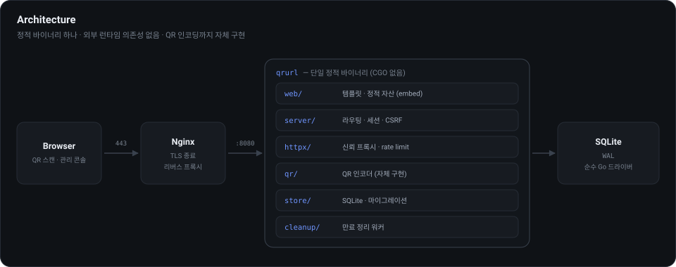
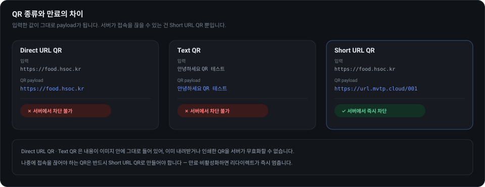
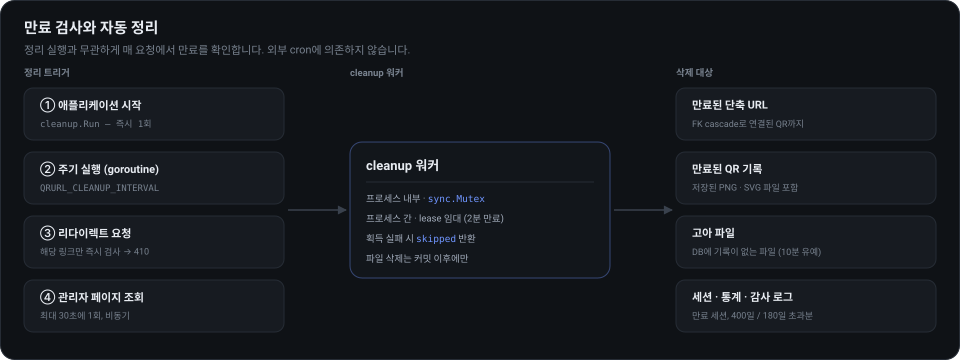

# QR Code Generator + URL Shortener

개인용 QR 코드 생성기와 URL 단축 서비스입니다.

* 서비스: <https://url.mvtp.cloud>
* 관리자: <https://url.mvtp.cloud/adminpage>

QR 코드는 **이 서버 안에서 직접 생성**합니다. 외부 QR API나 QR 리다이렉트 서비스를
전혀 사용하지 않으며, 입력한 값이 그대로 QR payload가 됩니다.

```
Input : https://food.hsoc.kr
Decode: https://food.hsoc.kr
```



---

## 목차

1. [기능](#기능)
2. [QR 만료에 대한 중요한 제약](#qr-만료에-대한-중요한-제약)
3. [기술 스택](#기술-스택)
4. [프로젝트 구조](#프로젝트-구조)
5. [빠른 시작](#빠른-시작)
6. [설정](#설정)
7. [CLI](#cli)
8. [HTTP API](#http-api)
9. [데이터 모델](#데이터-모델)
10. [만료와 자동 삭제](#만료와-자동-삭제)
11. [보안](#보안)
12. [테스트](#테스트)
13. [운영](#운영)
14. [배포](#배포)

---

## 기능

### QR 코드

| 종류 | payload | 서버에서 접속 차단 가능 |
|---|---|---|
| Direct URL QR | 입력한 URL 그대로 | ✗ |
| Text QR | 입력한 문자열 그대로 | ✗ |
| Short URL QR | `https://url.mvtp.cloud/001` | ✓ |

* 실시간 미리보기, PNG / SVG 다운로드
* 크기 64 ~ 2048 px, 오류 정정 레벨 L / M / Q / H
* Quiet Zone 4 모듈 유지, 버전 1 ~ 40 자동 선택
* Numeric / Alphanumeric / Byte / **Kanji** 4개 모드 자동 선택
  (일본어는 문자당 13비트로 저장되어 UTF-8 byte 모드보다 심볼이 작습니다)
* 카메라 인식을 위해 픽셀 격자에 정확히 맞춰 렌더링
* Direct URL QR 생성 화면에서 한 번의 클릭으로 취소 가능한 Short URL QR로 전환

### URL 단축

* `https://url.mvtp.cloud/001` ~ `https://url.mvtp.cloud/999` (항상 숫자 3자리)
* 자동 할당(가장 작은 빈 번호) 또는 관리자 직접 지정
* 활성 / 비활성, 대상 주소 수정, 코드 변경, 삭제
* 클릭 수, 마지막 접속 시각 기록
* 활성이고 만료되지 않은 링크만 `302 Found`

### 관리자 페이지 `/adminpage`

* **대시보드**: 활성 단축 URL 수, QR 수, 오늘 생성 수, 오늘 리다이렉트 수,
  누적 클릭 수, 남은 코드 수, 곧 만료되는 항목, 최근 생성 항목, 14일 활동 그래프,
  자동 정리 실행 이력
* **단축 URL 관리**: 목록 · 검색 · 정렬 · 생성 · 수정 · 삭제 · 활성/비활성 ·
  Short URL 복사 · QR 생성 · 만료기간 변경 및 연장
* **QR 관리**: 목록 · 미리보기 · 종류 · 실제 payload · 생성일 · 만료일 · 남은 시간 ·
  연결된 Short URL · PNG/SVG 다운로드 · payload 복사 · 다시 생성 · 삭제 ·
  만료기간 변경 및 연장
* **설정**: 비밀번호 변경 · 다른 세션 일괄 로그아웃 · 활성 세션 수 ·
  24시간 내 로그인 실패 횟수 · 감사 로그 · CSV/JSON 내보내기 · 진단 정보
* 목록은 항상 전체 개수를 함께 표시하고, QR 목록은 "더 불러오기"로 이어 봅니다
* 데스크톱/모바일 반응형, 라이트/다크 모드 자동 대응
* 상태 배지: `활성` `비활성` `곧 만료` `만료됨`
* 삭제는 확인 절차를 거치며, 단축 URL 삭제 시 코드를 직접 입력해야 합니다

---

## QR 만료에 대한 중요한 제약



서버는 **QR 기록과 서버에 저장된 PNG/SVG 파일**만 만료·삭제할 수 있습니다.

* **Direct URL QR / Text QR** 은 내용이 이미지 안에 그대로 들어 있습니다.
  사용자가 이미 내려받았거나 인쇄한 QR은 서버에서 무효화할 수 없습니다.
  만료 처리를 해도 그 이미지를 스캔하면 여전히 원래 주소로 연결됩니다.
* **Short URL QR** 은 `url.mvtp.cloud/001` 을 담습니다. 서버에서 만료하거나
  비활성화하면 **실제 접속도 즉시 차단**됩니다.

따라서 나중에 접속을 끊어야 하는 QR은 반드시 Short URL QR로 만들어야 합니다.
이 차이는 공개 페이지와 관리자 페이지 양쪽에 문구와 배지로 표시됩니다.

---

## 기술 스택

| 영역 | 사용 기술 |
|---|---|
| 언어 | Go 1.27 (`go.mod` 기준, 그 이상이면 동작) |
| HTTP 서버 | 표준 `net/http` — Go 1.22 라우팅 패턴 (`GET /adminpage/api/shorturls/{id}`) |
| 템플릿 | 표준 `html/template` (문맥 인식 자동 이스케이프) |
| 프런트엔드 | HTML5 + CSS + Vanilla JavaScript — 번들러·트랜스파일러·프레임워크 없음 |
| 정적 자산 | `embed.FS` 로 바이너리에 포함 (배포 시 별도 파일 불필요) |
| 데이터베이스 | SQLite 3.53.3, WAL 모드 — `modernc.org/sqlite` (순수 Go, cgo 불필요) |
| 마이그레이션 | 자체 구현 (`internal/store/migrate.go`), 기동 시 자동 적용·재실행 안전 |
| 비밀번호 해싱 | Argon2id — 64 MiB, t=3, p=min(CPU,4), PHC 문자열 |
| 세션·토큰 | `crypto/rand` 32바이트, DB에는 SHA-256 해시만 저장 |
| QR 인코딩 | **자체 구현** (`internal/qr`) — ISO/IEC 18004. 외부 라이브러리·API 없음 |
| QR 디코딩 | **자체 구현** (`internal/qrdecode`) — 라운드트립 검증 전용 |
| 로깅 | 표준 `log/slog` (JSON / text) |
| 빌드 | `CGO_ENABLED=0` 정적 링크, `-trimpath`, Makefile |
| 테스트 | 표준 `testing` + `go vet` + `staticcheck` + 레이스 디텍터 |
| 컨테이너 | 멀티스테이지 Dockerfile (build / test / runtime), distroless 급 최소 이미지 |
| 배포 | Ubuntu Server + systemd + Nginx, 또는 Docker + Compose |

**직접 의존성은 네 개뿐입니다.** 모두 Go 공식(`golang.org/x`) 또는 순수 Go 구현체입니다.

| 모듈 | 버전 | 용도 |
|---|---|---|
| `modernc.org/sqlite` | v1.57.0 | SQLite 드라이버 (순수 Go, cgo 없음) |
| `golang.org/x/crypto` | v0.55.0 | Argon2id |
| `golang.org/x/term` | v0.45.0 | `setpassword` 비밀번호 입력 숨김 |
| `golang.org/x/text` | v0.41.0 | Kanji 모드용 Shift-JIS 변환 |

의도적으로 **쓰지 않은** 것들입니다.

* 웹 프레임워크 (Gin, Echo, Fiber …) — 표준 `net/http` 로 충분
* ORM — SQL을 `internal/store` 에 직접 작성, 전 구간 파라미터 바인딩
* 프런트엔드 프레임워크·빌드 도구 (React, Vue, Vite, npm) — 런타임에 Node.js 불필요
* QR 라이브러리·외부 QR API — payload 동일성을 보장할 수 없고, 리다이렉트 서비스가 끼어들 여지가 생김
* cgo — 정적 바이너리 하나로 배포하고 glibc 버전에 묶이지 않기 위해

프로덕션 런타임 의존성은 **Go 바이너리 하나**입니다.

---

## 프로젝트 구조

```
.
├── cmd/
│   ├── qrurl/            서버 + CLI (serve, setpassword, backup, version)
│   └── qrdecode/         검증용 QR 디코더 (PNG/SVG → payload)
├── internal/
│   ├── auth/             Argon2id, 세션·CSRF 토큰 (crypto/rand)
│   ├── cleanup/          만료 데이터 정리 워커
│   ├── config/           QRURL_* 환경변수
│   ├── httpx/            신뢰 프록시, 클라이언트 IP, 토큰 버킷 rate limiter
│   ├── qr/               QR 인코더 (ISO/IEC 18004) + PNG/SVG 렌더러
│   ├── qrdecode/         독립 구현 QR 디코더 (라운드트립 검증용)
│   ├── qrfile/           QR 파일 저장·삭제·고아 파일 정리
│   ├── server/           HTTP 핸들러, 미들웨어, 세션, JSON API, 감사·계정·내보내기
│   ├── store/            SQLite 접근, 마이그레이션, 감사 로그, 모든 SQL
│   └── validate/         입력 검증 규칙
├── web/
│   ├── templates/        layout, home, login, admin, notice
│   └── static/           app.css, home.js, admin.js, favicon.svg
├── deploy/
│   ├── qrurl.service     systemd 유닛 (샌드박싱 포함)
│   ├── qrurl.env.example 환경변수 예시
│   └── nginx/            리버스 프록시 설정 (호스트용 / Docker용)
├── docs/
│   ├── DEPLOY-UBUNTU.md  Ubuntu systemd 배포 절차
│   ├── DEPLOY-DOCKER.md  Docker + internal-nginx 배포 절차
│   └── img/              README 도식 (SVG)
├── Dockerfile            멀티스테이지 (build / test / runtime)
├── compose.yaml          운영: mvtp-web-net 합류, 포트 미공개
├── compose.dev.yaml      개발: 127.0.0.1:8013 공개
└── Makefile
```

---

## 빠른 시작

```bash
git clone https://github.com/deploy103/qr-url-web.git
cd qr-url-web

# Go 1.27 이상 필요
go version

# 로컬 실행 (data/ 디렉터리에 DB와 QR 파일 생성)
make run
```

첫 실행 시 관리자 계정이 없으면 자동으로 생성되고, 무작위 비밀번호가 **표준 에러로
한 번만** 출력됩니다. 이 값은 구조화 로그에는 기록되지 않습니다.

```
=========================================================
 관리자 계정이 생성되었습니다.
   아이디   : admin
   비밀번호 : 3fJ2c-...
 이 값은 다시 표시되지 않습니다. 지금 저장한 뒤
 `qrurl setpassword` 로 원하는 비밀번호로 변경하세요.
=========================================================
```

비밀번호를 직접 정하려면:

```bash
make setpassword
```

접속:

* <http://127.0.0.1:8080/> — 공개 QR 생성기
* <http://127.0.0.1:8080/adminpage> — 관리자

---

## 설정

모든 설정은 `QRURL_` 접두어 환경변수로 합니다.

| 변수 | 기본값 | 설명 |
|---|---|---|
| `QRURL_ADDR` | `127.0.0.1:8080` | 바인드 주소. 프로덕션에서는 반드시 루프백 |
| `QRURL_BASE_URL` | `https://url.mvtp.cloud` | 공개 origin. Short URL QR payload의 기준 |
| `QRURL_DATA_DIR` | `./data` | DB·QR 파일·백업의 상위 디렉터리 |
| `QRURL_DB` | `<DATA_DIR>/qrurl.db` | SQLite 파일 경로 |
| `QRURL_QR_DIR` | `<DATA_DIR>/qr` | 렌더링된 QR 파일 디렉터리 |
| `QRURL_BACKUP_DIR` | `<DATA_DIR>/backups` | 자동 백업 디렉터리 |
| `QRURL_TIMEZONE` | `Asia/Seoul` | "오늘" 집계와 사용자 지정 만료 해석 기준 |
| `QRURL_SESSION_TTL` | `12h` | 관리자 세션 수명 |
| `QRURL_CLEANUP_INTERVAL` | `5m` | 만료 정리 주기 |
| `QRURL_BACKUP_INTERVAL` | `24h` | 자동 백업 주기 (`0` 이면 비활성) |
| `QRURL_BACKUP_KEEP` | `14` | 보관할 백업 개수 |
| `QRURL_MAX_BODY_BYTES` | `65536` | 요청 본문 상한 |
| `QRURL_SECURE_COOKIE` | `true` | 쿠키 `Secure` 속성 |
| `QRURL_HSTS` | `true` | `Strict-Transport-Security` 헤더 |
| `QRURL_TRUST_PROXY` | `true` | `X-Real-IP` / `X-Forwarded-For` 신뢰 여부 |
| `QRURL_TRUSTED_PROXIES` | `127.0.0.1/32,::1/128` | 위 헤더를 믿을 peer 네트워크 목록 (CIDR, 쉼표 구분) |
| `QRURL_PUBLIC_QR` | `true` | 공개 QR 생성기 활성화 |
| `QRURL_PUBLIC_QR_ALLOW` | (없음) | 공개 QR 생성기를 허용할 네트워크 (CIDR). 비우면 전체 허용 |
| `QRURL_REDIRECT_RATE` | `120` | 주소당 분당 리다이렉트 상한 (코드 열거 속도 제한) |
| `QRURL_SINGLE_INSTANCE` | `true` | 데이터 디렉터리를 다른 프로세스가 쓰고 있으면 기동 거부 |
| `QRURL_LOG_LEVEL` | `info` | `debug` `info` `warn` `error` |
| `QRURL_LOG_FORMAT` | `json` | `json` 또는 `text` |
| `QRURL_ADMIN_USERNAME` | `admin` | 최초 1회 계정 생성 시에만 사용 |
| `QRURL_ADMIN_PASSWORD` | (없음) | 최초 1회 계정 생성 시에만 사용 |

---

## CLI

```bash
qrurl                  # = qrurl serve
qrurl serve            # HTTP 서버 시작
qrurl setpassword      # 관리자 비밀번호 변경 (기존 세션 전부 로그아웃)
qrurl setpassword -stdin < pw.txt
qrurl backup           # VACUUM INTO 로 일관성 있는 사본 생성
qrurl backup -out /tmp/snapshot.db
qrurl version
```

검증용 디코더:

```bash
qrdecode qr.png
# version=3 level=M mask=2 corrections=0
# https://example.com/abc?a=1&b=2
```

---

## HTTP API

### 공개

| 메서드 | 경로 | 설명 |
|---|---|---|
| `GET` | `/` | QR 생성기 페이지 |
| `GET` | `/{001..999}` | 단축 URL 리다이렉트 (`302`) |
| `GET` | `/qr.png?data=&ec=&size=&download=&name=` | PNG 렌더링 (저장하지 않음) |
| `GET` | `/qr.svg?...` | SVG 렌더링 |
| `GET` | `/health` | 상태 점검 JSON |
| `GET` | `/robots.txt` | 전체 색인 거부 |

### 관리자 (세션 + CSRF 필요)

| 메서드 | 경로 | 설명 |
|---|---|---|
| `GET` | `/adminpage` | 관리 콘솔 |
| `GET`/`POST` | `/adminpage/login` | 로그인 |
| `POST` | `/adminpage/logout` | 로그아웃 |
| `GET` | `/adminpage/api/overview` | 대시보드 데이터 |
| `GET`/`POST` | `/adminpage/api/shorturls` | 목록 / 생성 |
| `PATCH`/`DELETE` | `/adminpage/api/shorturls/{id}` | 수정 / 삭제 |
| `POST` | `/adminpage/api/shorturls/{id}/extend` | 만료 연장 |
| `POST` | `/adminpage/api/shorturls/{id}/qr` | 이 단축 URL의 QR 생성 |
| `GET`/`POST` | `/adminpage/api/qrcodes` | 목록 / 생성 |
| `PATCH`/`DELETE` | `/adminpage/api/qrcodes/{id}` | 수정 / 삭제 |
| `POST` | `/adminpage/api/qrcodes/{id}/extend` | 만료 연장 |
| `POST` | `/adminpage/api/qrcodes/{id}/regenerate` | 다시 렌더링 |
| `POST` | `/adminpage/api/cleanup` | 만료 정리 즉시 실행 |
| `GET` | `/adminpage/api/account` | 계정·세션·감사 로그·진단 |
| `POST` | `/adminpage/api/account/password` | 비밀번호 변경 |
| `POST` | `/adminpage/api/account/sessions/revoke` | 다른 세션 로그아웃 |
| `GET` | `/adminpage/api/export/{shorturls\|qrcodes\|audit}?format=csv\|json` | 내보내기 |
| `GET` | `/adminpage/qr/preview.png\|.svg?data=...` | 저장하지 않는 관리자 미리보기 |
| `GET` | `/adminpage/qr/{id}.png\|.svg[?download=1]` | 저장된 QR 파일 |

상태를 바꾸는 요청은 `X-CSRF-Token` 헤더가 필요합니다. 토큰은 `/adminpage` HTML의
`data-csrf` 속성으로 전달됩니다.

---

## 데이터 모델

```sql
short_urls(id, code, target_url, note, enabled, click_count,
           created_at, updated_at, last_accessed_at, expires_at)

qr_codes(id, kind, payload, label, short_code, ec_level, size, version,
         png_path, svg_path, created_at, updated_at, expires_at)

admin(id=1, username, password_hash, created_at, updated_at)
sessions(token_hash, csrf_token, created_at, expires_at, last_seen_at)
stats_daily(day, redirects, urls_created, qrs_created)
audit_log(id, created_at, action, subject, detail, ip, success)
cleanup_state(id=1, last_run_at, lease_until, runs, removed_urls, removed_qrs)
schema_migrations(version, name, applied_at)
```

* 시각은 모두 UTC unix 초. 만료 없음은 `expires_at IS NULL`.
* `code` 는 `[0-9][0-9][0-9]` 이고 `000` 은 CHECK 제약으로 거부됩니다.
* `qr_codes.short_code` → `short_urls.code` 는 `ON DELETE CASCADE`
  `ON UPDATE CASCADE`. 단축 URL을 지우면 연결된 QR 기록과 파일도 함께 사라집니다.
* `stats_daily` 는 별도 카운터라, 항목을 삭제해도 과거 통계는 남습니다.

---

## 만료와 자동 삭제

만료 옵션: **만료 없음 · 1시간 · 1일 · 7일 · 30일 · 사용자 지정 날짜/시간**
(사용자 지정 값은 `QRURL_TIMEZONE` 기준으로 해석되어 UTC로 저장됩니다.)



정리는 다음 네 시점에 동작합니다.

1. **애플리케이션 시작 시** — `cleanup.Run` 이 즉시 한 번 실행
2. **주기적 background goroutine** — `QRURL_CLEANUP_INTERVAL` 마다
3. **리다이렉트 요청 시** — 해당 링크가 만료되었으면 그 자리에서 삭제하고 `410`
4. **관리자 페이지 조회 시** — 최대 30초에 한 번 비동기로 실행

정리 과정:

* 만료된 단축 URL 삭제 → FK cascade로 연결된 QR 기록도 삭제
* 만료된 QR 기록 삭제
* 위에서 나온 PNG/SVG 파일을 **커밋 이후에** 디스크에서 삭제
* DB에 없는 고아 파일 정리 (10분 유예)
* 만료된 세션 삭제, 400일 지난 통계 행 정리, 180일 지난 감사 로그 정리

**동시 실행 안전성**

* 프로세스 내부: `sync.Mutex`
* 프로세스 간: `cleanup_state.lease_until` 을 `UPDATE ... WHERE lease_until <= now`
  로 잡는 임대 방식. 획득에 실패한 쪽은 아무 일도 하지 않고 `skipped` 를 반환합니다.
* 임대는 2분 뒤 자동 만료되므로 크래시가 나도 영구히 막히지 않습니다.
* 파일 삭제는 트랜잭션 커밋 후에만 수행하므로, 롤백이 나도 기록만 남고 파일이
  사라지는 상태는 생기지 않습니다.

만료 여부는 **정리 실행과 무관하게** 매 요청에서 확인합니다. background cleanup이
아직 돌지 않았어도 만료된 링크는 절대 리다이렉트하지 않습니다.

---

## 보안

| 항목 | 구현 |
|---|---|
| 비밀번호 | Argon2id (64 MiB, t=3, p=CPU수 최대 4), PHC 문자열, 16바이트 랜덤 salt |
| 세션 | 서버 측 저장. 쿠키는 32바이트 `crypto/rand` 토큰, DB에는 SHA-256 해시만 |
| 쿠키 | `HttpOnly`, `Secure`(설정), `SameSite=Lax`, `Path=/adminpage` |
| 세션 고정 | 로그인마다 새 토큰 발급. 비밀번호 변경 시 현재 세션도 회전하고 나머지는 삭제 |
| CSRF | 세션 바인딩 토큰 + `Origin`/`Sec-Fetch-Site` 확인. 로그인 폼은 double-submit 쿠키 |
| XSS | `html/template` 자동 이스케이프. 관리 화면은 전부 `createElement`/`textContent` |
| CSP | `default-src 'none'` 기반. inline script/style 없음, `frame-ancestors 'none'` |
| SQL Injection | 전 구간 파라미터 바인딩. 정렬·상태 필터는 허용 목록. LIKE 와일드카드 이스케이프 |
| URL 검증 | `http`/`https` 만 허용. `javascript:` `data:` `file:` `vbscript:` 등 거부. 인증정보 포함 URL 거부 |
| SSRF | 대상 URL을 서버가 **fetch 하거나 preview 하지 않음** |
| Rate limit | 로그인 IP별 10회/15분 + 전역 60회/15분, 공개 QR 120회/분, 관리 API 600회/분. 키가 넘치면 잠금이 아니라 LRU 축출 |
| 프록시 헤더 | `QRURL_TRUSTED_PROXIES` 안에서 들어온 요청만 `X-Real-IP`/`X-Forwarded-For`를 신뢰 |
| 코드 열거 | 리다이렉트를 주소당 분당 `QRURL_REDIRECT_RATE` 회로 제한 (존재하지 않는 코드 조회도 소모) |
| 내보내기 | GET 다운로드도 세션 바인딩 CSRF 토큰을 쿼리로 요구 + Origin 검증 |
| 단일 인스턴스 | 데이터 디렉터리에 `flock` 기반 락. 두 번째 프로세스는 보유자를 알려주며 기동 거부 |
| 로그인 타이밍 | 계정이 없어도 동일한 Argon2 연산을 수행해 존재 여부가 응답 시간으로 새지 않음 |
| 감사 로그 | 로그인·실패·로그아웃·생성/수정/삭제/만료변경·정리·내보내기를 IP와 함께 180일 보관 |
| 요청 크기 | `MaxBytesReader` 64 KiB, 헤더 64 KiB |
| 보안 헤더 | CSP, HSTS, `X-Content-Type-Options`, `X-Frame-Options`, `Referrer-Policy`, `Permissions-Policy`, COOP, CORP |
| 경로 순회 | QR 파일명은 `^[a-f0-9]{8,64}\.(png\|svg)$` 정규식으로만 허용 |
| 접근 제어 | 저장된 QR 파일도 DB 기록을 먼저 확인 후 제공. 삭제·만료된 QR은 접근 불가 |
| 로깅 | 비밀번호·토큰·쿼리스트링을 기록하지 않음 |
| 정보 노출 | 공개 `/health`는 상태만 반환. 버전·SQLite·스키마는 루프백 호출과 인증된 콘솔에서만 |
| CSV 내보내기 | `=`, `+`, `-`, `@` 로 시작하는 셀 앞에 `'` 를 붙여 스프레드시트 수식 실행을 차단 |

---

## 테스트

```bash
make test        # 전체
make test-race   # 레이스 디텍터
make check       # vet + staticcheck + test + gofmt 확인
make cover       # 커버리지
```

주요 검증 내용:

* **QR payload 동일성** — `https://example.com/abc?a=1&b=2` 를 인코딩한 뒤
  렌더링된 PNG와 SVG를 다시 디코딩해 원본과 바이트 단위로 비교
* **독립 구현 대조** — `internal/qr` 이 만든 모듈 행렬을 Python `segno` 1.6.6이
  만든 행렬과 **버전 1~40 × 레벨 L/M/Q/H × 마스크 0~7** 에 걸쳐 비교
  (`internal/qr/testdata/segno_vectors.json.gz`, 484 케이스)
* **컨테이너 안에서도 동일 검증** — `docker build --target test .` 가 `go vet` 과
  전체 테스트를 실행하므로, 이미지가 통과하지 못하면 빌드가 실패합니다
* Reed-Solomon 오류 정정이 실제로 손상된 심볼을 복구하는지
* 001/999 경계, 코드 소진, 자동 할당 재사용, 동시 생성 시 충돌 없음
* 리다이렉트, 비활성, 삭제, 만료 차단, 만료 시 즉시 삭제
* QR 만료, 자동 정리, 파일 삭제, 고아 파일 정리, 동시 정리 직렬화
* 관리자 인증, 세션 만료, 로그아웃, 로그인 rate limit
* CSRF(토큰 없음/위조/교차 출처), XSS, SQL Injection, 경로 순회, 본문 크기 제한
* 서버 재시작 후 데이터 유지

---

## 운영

* `GET /health` — 상태와 uptime (루프백에서 호출하면 버전·SQLite·스키마도 함께)
* 감사 로그 — 관리자 동작을 IP와 함께 180일 보관, 콘솔과 CSV/JSON으로 열람
* 구조화 로깅 — `log/slog` JSON. 요청 메서드·경로·상태·크기·소요시간·IP
* DB 마이그레이션 — 시작할 때 자동 적용, 재실행 안전
* 백업 — `qrurl backup` 또는 `QRURL_BACKUP_INTERVAL` 주기 자동 백업(`VACUUM INTO`)
* Graceful shutdown — `SIGTERM` 수신 시 진행 중 요청을 마치고 DB를 닫음

---

## 배포

두 가지 방식을 지원합니다.

**systemd** — [`docs/DEPLOY-UBUNTU.md`](docs/DEPLOY-UBUNTU.md)

```
Internet → Nginx (TLS, 443) → 127.0.0.1:8080 (qrurl) → SQLite (WAL)
```

**Docker** — [`docs/DEPLOY-DOCKER.md`](docs/DEPLOY-DOCKER.md)

```
Internet → edge → internal-nginx → qr-url:8013 (mvtp-web-net) → SQLite (WAL)
```

```bash
docker compose up -d --build          # 운영: 포트를 호스트에 공개하지 않음
docker compose -f compose.dev.yaml up -d --build   # 개발: 127.0.0.1:8013
```

컨테이너는 정적 바이너리 하나만 담아 약 40 MB이고, non-root(`10001`)로 실행되며
`read_only` 루트 파일시스템 + `cap_drop: ALL` + `no-new-privileges` 로 동작합니다.
